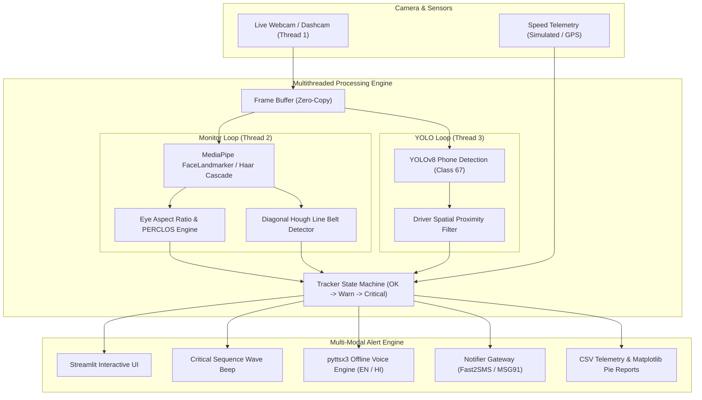

🛡️ Drive Saarthi — AI Driver Safety & Assurance System

<div align="center">

[](https://www.python.org/)
[](https://streamlit.io/)
[](https://opencv.org/)
[](https://developers.google.com/mediapipe)
[](https://docs.ultralytics.com/)
[](https://pytest.org/)

**Real-time intelligent cabin monitoring system for fatigue, distraction, seatbelt compliance, and overspeed detection with automated progressive alert escalation.**

[Features](#-key-features) • [Architecture](#-system-architecture) • [Quick Start](#-quick-start) • [Visual Showcase](#-visual-showcase) • [Configuration](#-configurable-parameters) • [Roadmap](#-roadmap)

</div>

---

## 📌 Overview

**Drive Saarthi** is an edge-ready, computer-vision safety assistant engineered to detect hazardous driver behaviors in real time. Designed for vehicle cabins and fleet management, it monitors driver face mesh landmarks, eye aspect ratios, mobile device usage, and chest seatbelt positioning across high-speed multithreaded pipelines.

When risky driving behavior is sustained, the system automatically escalates through a progressive alert hierarchy:
$$\text{OK (Normal)} \longrightarrow \text{Attention Warning} \longrightarrow \text{Critical Intervention}$$

Critical episodes trigger multi-modal responses including **audible alert beeps**, **offline multilingual voice warnings (English & Hindi)**, and **automated emergency SMS notifications** containing live GPS telemetry.

---

## ✨ Key Features

| Capability | Detection Method | Description |
| :--- | :--- | :--- |
| 😴 **Drowsiness & Fatigue** | MediaPipe Tasks + EAR + PERCLOS | Computes Eye Aspect Ratio (EAR) across 478 face landmarks and cumulative 60s eye closure percentage (PERCLOS). |
| 📱 **Phone Distraction** | YOLOv8 COCO + Spatial Proximity | Detects phone devices and filters out passenger/dash-mount items by computing Euclidean proximity to driver head & hands. |
| 🎗️ **Seatbelt Compliance** | Hough Line Transform / Custom Model | Scans the driver's chest region of interest (ROI) for diagonal strap edges (30°–75°/105°–150°) with moving-vote stabilization. |
| 🚗 **Speed Enforcement** | Telemetry Simulation / Manual Input | Compares vehicle speed against dynamic zone limits with configurable thresholds. |
| 🔊 **Audible & Voice Alerts** | Pyttsx3 TTS Engine + PCM Wave Beeps | Escalates spoken warnings in English or Hindi as violations continue unaddressed without blocking video analysis. |
| 📲 **Emergency SMS Dispatch** | Fast2SMS / MSG91 / Twilio API | Sends urgent alert messages with driver name, duration, speed, and GPS map coordinates to registered contacts. |
| 📊 **Windowed Analytics** | Automated CSV & Pie Chart Generation | Generates incident breakdown reports every 5 minutes and saves summary analytics for fleet managers. |

---

## 📸 Visual Showcase

### Live Dashboard Preview
<!-- Replace this placeholder with your actual dashboard screenshot (e.g. assets/dashboard_overview.png) -->
```
+-----------------------------------------------------------------------------------------+
|  [🛡️ Driver Assurance: Live Cabin Monitoring]                                           |
|  +----------------------------------------------------+  +----------------------------+ |
|  |  [CAMERA FEED (640x480 Live)]                      |  | STATUS PANEL               | |
|  |                                                    |  |                            | |
|  |    +----------------------+                        |  | 🎗️ Seatbelt    [Fastened] | |
|  |    |  (•_•)  Face BBox    |  [Eye openness: 0.31]  |  | 🚗 Speed       [60 km/h]  | |
|  |    +----------------------+                        |  | 😴 Drowsiness  [Eyes open]| |
|  |         \                                          |  | 📱 Phone       [Clear]    | |
|  |          \  Seatbelt ROI                           |  | 📷 Camera Feed [Live 18fps]| |
|  |           \                                        |  +----------------------------+ |
|  +----------------------------------------------------+                                 |
|  [ 60 km/h Speed ] | [ 0.31 Eye Openness ] | [ 18 FPS Analysis ] | [ 04:32 Next Report ]|
+-----------------------------------------------------------------------------------------+
```

### Telemetry & Issue Breakdown Report
Automated window reports generate breakdown charts displaying incident distribution across driving sessions:

<div align="center">
  
  <p><i>Figure: Automated pie chart distribution generated during an active driving window.</i></p>
</div>

---

## 🏗️ System Architecture



---

## 🚀 Quick Start

### 1. Prerequisites
- Python 3.10, 3.11, 3.12, or 3.14
- Webcam or USB capture device
- (Optional) Microphone / Speakers for audio & voice alerts

### 2. Clone the Repository
```bash
git clone https://github.com/YOUR_GITHUB_USERNAME/Drive-Saarthi.git
cd Drive-Saarthi
```

### 3. Create a Virtual Environment
```bash
# Windows
python -m venv .venv
.venv\Scripts\activate

# macOS / Linux
python3 -m venv .venv
source .venv/bin/activate
```

### 4. Install Dependencies
```bash
pip install -r requirements.txt
```

### 5. Launch the Application
```bash
streamlit run app.py
```
Open your browser at `http://localhost:8501`. Register an account or sign in to begin real-time monitoring!

---

## ⚙️ Configurable Parameters

Customize thresholds in real time using the Streamlit sidebar:

| Parameter | Default | Range | Description |
| :--- | :---: | :---: | :--- |
| `speed_limit` | `80 km/h` | 20 – 160 | Maximum authorized road speed before alert. |
| `ear_threshold` | `0.21` | 0.10 – 0.35 | Eye aspect ratio cutoff below which eyes count as closed. |
| `perclos_limit` | `0.30` | 0.10 – 0.50 | Max proportion of closed-eye time over 60s before fatigue alert. |
| `confirm_after` | `1.5 s` | 0.5 – 5.0 | Sustained duration required before flagging an issue. |
| `min_speed_checks` | `5.0 km/h` | 0 – 60 | Disables seatbelt/phone checks when vehicle is safely parked. |
| `realert_every` | `10.0 s` | 3 – 120 | Re-trigger frequency for unresolved critical warnings. |
| `voice_lang` | `"en"` | `en` / `hi` | Language for spoken voice intervention warnings. |

---

## 🧪 Testing

The system includes a full suite covering state tracking, SMS sanitization, voice alerts, heuristic geometry, and database authentication:

```bash
python -m pytest test_project.py -v
```
Output:
```text
======================= 36 passed in 18.5s =======================
```

---

## 📁 Project Structure

```text
Drive-Saarthi/
├── app.py                  # Main entrypoint & multi-page navigation
├── frontend.py             # Streamlit real-time monitoring dashboard
├── backend.py              # Multithreaded computer vision & tracker engine
├── detectors.py            # MediaPipe Tasks, OpenCV Haar & YOLO models
├── driver_profile.py       # Driver profile & emergency contact settings
├── auth.py                 # SQLite secure user management & credentials
├── notifier.py             # SMS dispatch gateway (MSG91 / Fast2SMS)
├── voice.py                # Offline text-to-speech engine (pyttsx3)
├── reporting.py            # Incident analysis & pie chart generation
├── theme.py                # Custom CSS UI styling
├── test_project.py         # Complete backend test suite
├── assets/                 # Screenshots, demo GIFs, and report images
│   └── sample_report.png   # Sample generated driving analytics chart
├── models/                 # Model assets folder
│   └── face_landmarker.task # MediaPipe Tasks model (auto-loaded)
└── requirements.txt        # Project dependencies
```

---

## 💡 How to Make This Repository Stand Out on GitHub

Want to make your project look like a top-tier open-source repository? Follow these tips:

1. **Add a Live Demo GIF or Video**:
   - Use [ScreenToGif](https://www.screentogif.com/) (Windows) or OBS Studio to record a 10–15 second clip showing you in front of the camera:
     - Blinking / closing eyes to show the **Drowsiness Warning**.
     - Holding up a phone to show **Phone Detected (Bounding Box)**.
   - Save the recording as `assets/demo.gif` and embed it in this README using ``.

2. **Add 3 Screenshot Cards (All Clear / Warning / Critical)**:
   - Capture side-by-side screenshots showing:
     - 🟢 **Normal State:** Driver alert, seatbelt on, all metrics green.
     - 🟡 **Warning State:** Eyes drooping or phone lifted, countdown timer active.
     - 🔴 **Critical State:** Red border flashing, audio beep active.
   - Display them in a clean 3-column table:
     ```markdown
     | 🟢 All Clear | 🟡 Warning State | 🔴 Critical State |
     | :---: | :---: | :---: |
     |  |  |  |
     ```

3. **Add GitHub Social Preview**:
   - In your GitHub repo settings (`Settings` → `General` → `Social preview`), upload a clean 1280x640 banner image with the project logo and tagline.

---

## 👤 Author

**Aarushi**  
*Master of Computer Applications (MCA) Student • Aspiring Data & AI Professional*

- GitHub: AarushiRathore(https://github.com/AarushiRathore)
- LinkedIn: [Connect on LinkedIn](https://www.linkedin.com/in/YOUR_LINKEDIN_USERNAME)
- Email: rathoreaarushi2005@gmail.com(mailto:rathoreaarushi2005@gmail.com)

---

## ⚖️ License & Disclaimer

This project is open-source under the [MIT License](LICENSE).  
*Disclaimer: Drive Saarthi is an academic research and engineering prototype. It is intended for testing, demonstration, and research purposes, and is not a certified automotive safety appliance.*
